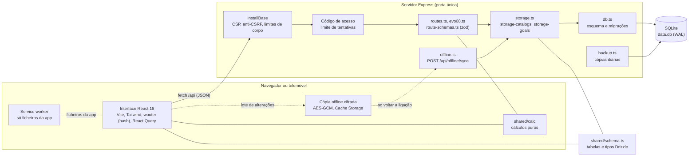
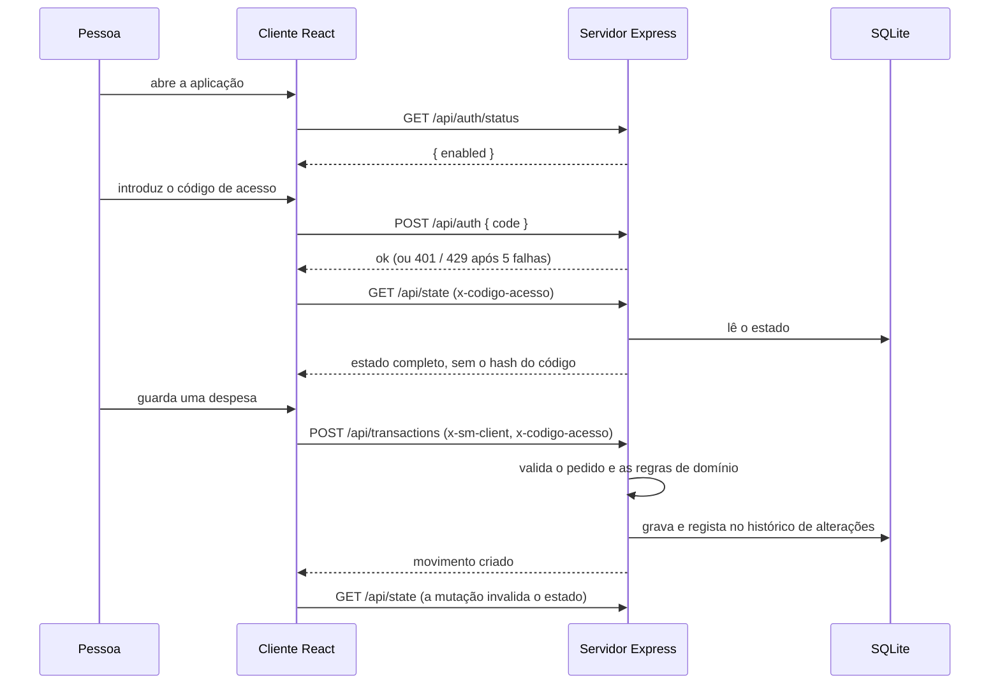
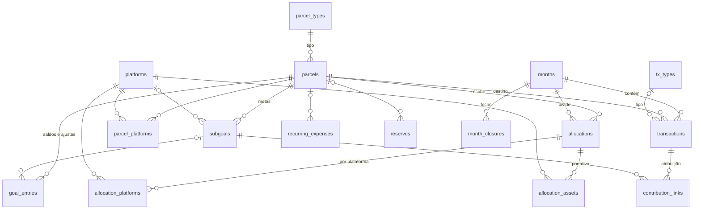
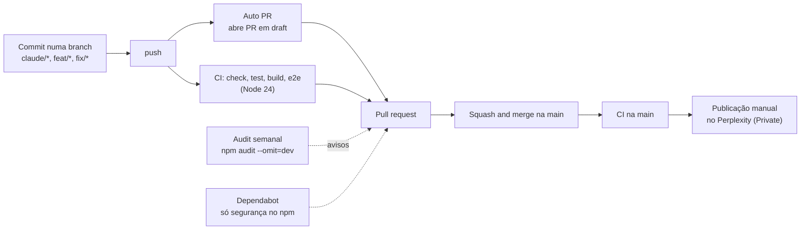

# Arquitetura

## Visão geral
Aplicação full-stack numa só porta: o servidor Express serve a API REST (`/api`) e o cliente React já compilado. Não usa serviços externos: os dados ficam numa base SQLite no próprio servidor.

Os cálculos (`shared/calc`) correm no navegador e no servidor com o mesmo código. O esquema e os tipos (`shared/schema.ts`) são partilhados entre as duas pontas.

## Pedido típico: entrar e guardar uma despesa

## Estrutura
| Pasta ou ficheiro | Função |
|---|---|
| `client/src/pages` | Ecrãs: dashboard, months, expenses, closing, parcels, portfolio, budget, data, help |
| `client/src/components` | Componentes partilhados (goal-panel, confirm, editable-section-grid, catalogs, layout, lock-screen) |
| `client/src/lib` | Estado (`app.tsx`: useAppState/useDerived/useSave), queryClient, layout de páginas, cópia offline (`offline.ts`), conteúdo de ajuda |
| `client/src/lib/dashboard-model.ts` | Números do Painel (totais, comparação, séries, metas) como função pura |
| `client/public/sw.js` | Service worker: guarda só o invólucro público da app, nunca dados financeiros |
| `server/index.ts` | Arranque, ficheiros estáticos (produção) ou Vite (desenvolvimento), paragem ordenada |
| `server/middleware.ts` | Cabeçalhos, CSP em produção, limites de corpo, proteção anti-CSRF |
| `server/routes.ts` | Rotas, autenticação e limite de tentativas, validação de backups |
| `server/route-schemas.ts` | Esquemas zod das rotas de catálogos, metas, recorrências e reservas |
| `server/evo08.ts` | Fecho de mês, recorrências, reservas, importação CSV, verificação de dados, histórico |
| `server/offline.ts` | Sincronização em lote do modo offline (`/api/offline/sync`), idempotente por lote |
| `server/storage.ts` | Acesso a dados (meses, parcelas, movimentos, distribuições), seed, restauro transacional |
| `server/storage-catalogs.ts`, `server/storage-goals.ts` | Plataformas e tipos; saldos, ajustes, submetas, atribuições e taxas. Compostos em `storage` |
| `server/db.ts` | Ligação SQLite/Drizzle, criação e migração do esquema, `httpError` e `roundCents` |
| `server/backup.ts` | Cópias automáticas da base de dados |
| `shared/schema.ts` | Tabelas Drizzle e tipos |
| `shared/calc.ts` e `shared/calc/` | Cálculos puros; `calc.ts` reexporta `month`, `budget`, `distribution`, `goals`, `expenses` e `insights` (ritmo das metas, ano anterior, despesas fora do padrão) |
| `shared/pdf.ts` | Gerador de PDF a partir de Markdown simples, sem dependências; usado pelo relatório mensal |
| `client/src/components/insights.tsx` | Despesas fora do padrão e linha de ritmo das metas |
| `client/src/components/yoy.tsx`, `client/src/lib/yoy-selection.ts` | Cartões "Face ao ano anterior" do Painel e do Orçamento, com seletor de meses e de ano; a escolha fica em `localStorage` e vale nos dois ecrãs |
| `tests/` | Testes node:test (cálculos, integridade, API, segurança, offline, layout) |
| `e2e/` | Testes de interface com Playwright |
| `script/build.ts` | Build do cliente (Vite) e do servidor (esbuild, `dist/index.cjs`) |

## Modelo de dados (relações principais)
São ligações lógicas por identificador (colunas `*_id`), sem chaves estrangeiras SQL; a integridade é garantida pela camada de armazenamento e pela verificação de dados (`/api/verify`). Detalhe das colunas em [MODELO-DE-DADOS.md](MODELO-DE-DADOS.md).

`settings` tem uma única linha. `fx_rates`, `change_log`, `import_batches`, `schema_migrations` e `offline_receipts` não ligam por chave a outras tabelas.

## Camadas de proteção
1. `installBase` (`server/middleware.ts`): `X-Content-Type-Options`, `Referrer-Policy`, CSP estrita em produção, limites de corpo (1 MB por omissão, 10 MB no offline, 50 MB nas importações) e cabeçalho `x-sm-client` obrigatório em pedidos que alteram dados.
2. Código de acesso (`x-codigo-acesso`): guardado só como hash, com 5 falhas por IP em 15 minutos a bloquear novas tentativas (429).
3. Esquemas zod nas rotas: tipos, limites e valores permitidos; campos desconhecidos e ids de rota inválidos dão 400.
4. Regras de domínio no armazenamento (duplicados, moedas, saldos), com mensagens em português.
5. SQL só via Drizzle; gravações compostas numa transação SQLite.

Detalhe e riscos conhecidos em [SEGURANCA.md](SEGURANCA.md).

## Modo offline
Opcional. A cópia local do estado e a fila de alterações ficam cifradas (AES-GCM, chave derivada do código de acesso) no Cache Storage do navegador. O service worker guarda só os ficheiros públicos da app. Ao voltar a ligação, a fila vai em lote para `/api/offline/sync`: o servidor aplica o lote e o seu recibo na mesma transação, por isso um reenvio não duplica nada. Conflitos pedem revisão. Detalhe em [MOBILE-OFFLINE.md](MOBILE-OFFLINE.md).

## Fluxo de dados
1. O cliente carrega `/api/state` (estado completo) e deriva valores com `shared/calc` (`useDerived`).
2. Alterações usam mutações (`useSave`) que chamam a API e invalidam o estado.
3. As páginas usam funções únicas de cálculo: o acumulado de uma meta vem sempre de `goalTotalOf`/`goalBreakdown`.

## Do código à produção

O CI não publica: a publicação é manual (ver [PUBLICACAO.md](PUBLICACAO.md)). Detalhe dos jobs em [DESENVOLVIMENTO-E-TESTES.md](DESENVOLVIMENTO-E-TESTES.md).

## Decisões
- Hash routing: funciona em hospedagem estática e em iframes.
- Confirmações dentro da aplicação (`useConfirm`): `window.confirm` é bloqueado em iframes.
- Sem serviços externos: tudo corre localmente com SQLite.
- Cálculos puros em `shared/` para serem testáveis sem base de dados.
- Validação em duas camadas: forma do pedido nas rotas (zod), regras de domínio no armazenamento.

## Módulos de Meses
`pages/months.tsx` (lista) e `components/months/`: `month-editor`, `number-field`, `reconciliation-panel`, `platform-distribution`, `transactions-panel`.
